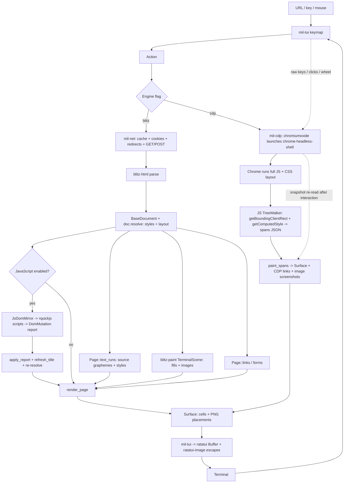

# Architecture

`mil` is a terminal web browser written in Rust. By default it uses the Blitz
HTML/CSS engine for parsing, cascade and layout, but instead of drawing to a GPU
surface it lowers the result into a terminal cell grid plus inline image
placements. A ratatui-based chrome (tab bar, omnibox, document viewport, status
bar) surrounds the page. An optional CDP backend (`--engine cdp`) delegates
parsing, JavaScript and layout to an external headless Chrome and feeds the
result into that same cell grid.

The workspace is split into focused crates so layout, networking and persistence
can be tested without a terminal. `mil-cdp` is the optional, heavier backend;
the other seven crates make up the self-contained default browser.

## Crates

| Crate | Kind | Responsibility |
| --- | --- | --- |
| `mil-app` | binary (`mil`) | `clap` CLI (including `--engine` and `--chrome`), current-thread `tokio` event loop, terminal lifecycle, tab model, navigation, script invocation, backend selection and session/bookmark wiring. |
| `mil-cdp` | library (optional backend) | Chrome DevTools Protocol client: launches/chromiumoxide-drives `chrome-headless-shell`, evaluates a JS DOM walker, maps its spans to a `mil-paint::Surface`, forwards input and captures image screenshots. |
| `mil-net` | library | `reqwest` + `rustls` fetching, manual `cookie_store` jar, bounded redirects, gzip/brotli decoding, bounded in-memory HTTP cache, `get`/`post_form` helpers. Used by Blitz mode; Chrome fetches pages itself in CDP mode. |
| `mil-dom` | library | `Page` wrapper around `blitz_dom::BaseDocument`: source text runs, link regions, backgrounds, hit testing, form discovery/serialization and `render_page`. |
| `mil-paint` | library | `TerminalScene`, a `PaintScene` recorder for fills and images; `Surface`, a cell grid (glyph + style) plus placed PNG images. No ratatui dependency. |
| `mil-tui` | library | ratatui chrome, `Surface` → `Buffer` conversion, ratatui-image protocol cache, keymap resolution, mouse handling and semantic `Action`s. |
| `mil-js` | library | Optional-at-runtime `rquickjs` 0.14 facade: a serialisable DOM mirror, recorded `DomMutation` report and `apply_report` to write those mutations back to a live Blitz document. |
| `mil-session` | library | TOML `Config`, JSON session/bookmarks snapshots, XDG path rules and atomic `0600` writes. Independent of the other crates. |

Dependency direction:

```
mil-app  -> mil-tui, mil-session, mil-net, mil-dom, mil-paint, mil-js, mil-cdp
mil-cdp  -> mil-paint (+ chromiumoxide 0.9.1, crossterm, serde_json)
mil-dom  -> mil-paint (+ Blitz, Stylo, Taffy, Parley)
mil-tui  -> mil-paint (+ ratatui, ratatui-image, crossterm)
mil-js   -> Blitz + rquickjs (mirror built from a live BaseDocument)
mil-net  -> independent
mil-session -> independent
```

`mil-js` is glued to `mil-dom` in `mil-app`, not depended on by it: it builds a
`JsDomMirror` from the same HTML (or from the live document) and returns a
report that `mil-app` applies. Likewise, `mil-cdp` is glued in `mil-app` only
when `--engine cdp` is selected; it does not depend on `mil-dom`, `mil-js`,
`mil-net` or `mil-tui` and instead produces the same `mil_paint::Surface` that
the Blitz path produces. `mil-paint` deliberately has no ratatui dependency so
the renderer can be exercised without a terminal.

## Data flow: loading a page

```
URL (omnibox / link / bookmark / CLI)
        |
        v
mil-net: cache lookup -> cookies -> redirects -> fetch (GET/POST)
        |
        v
blitz-html -> BaseDocument, then doc.resolve(): computed styles + layout
        |
        +-----------------------+------------------------+
        |                       |                        |
        v                       v                        v
Page::text_runs()      blitz-paint TerminalScene     Page::links()/forms()
(parley inline text)   (background fills + images)   (source text + hit regions)
        |                       |                        |
        +-----------------------+------------------------+
                                v
                    render_page() -> Surface (cells + PNG placements)
                                v
                 mil-tui Surface widget -> ratatui Buffer + image escapes
                                v
                              terminal
```

1. `mil-net` normalises the URL, consults the in-memory cache, attaches stored
   cookies, follows at most ten redirects and returns bytes plus headers.
   `Client::post_form` sends `application/x-www-form-urlencoded` bodies.
2. `Page::from_html` parses with `blitz-html` into a `BaseDocument` and caches
   the `<title>` text. `doc.resolve()` performs the cascade and layout.
3. **Hybrid text strategy.** Blitz/Parley emit font glyph IDs that cannot be
   reverse-mapped to source characters. `Page::text_runs()` therefore walks the
   resolved inline layout data and recovers each cluster's original text and
   computed style (colour, bold, italic, underline). `blitz-paint` is run only
   for solid backgrounds and image rectangles. This keeps text selectable and
   readable; exact glyph positions are approximated because CSS pixel advances
   do not equal terminal cell widths.
4. `render_page()` paints backgrounds first, places text graphemes contiguously
   in reading order per visual line, then clears image rectangles and attaches
   encoded PNGs. Cell styles become ratatui colours and modifiers; images are
   handed to ratatui-image.
5. `mil-tui` copies the visible cell range into the `Buffer`, clamps scroll to
   the document height and emits graphics escapes. Ratatui diffs the buffer on
   `draw`. Capability detection picks iTerm2 (OSC1337), Kitty or Sixel, with a
   half-blocks fallback (and alt text when no protocol is available). Protocol
   instances are cached per image id. `images.policy` and `images.protocol` are
   parsed but are not yet applied as overrides by the binary.

If JavaScript is enabled in Blitz mode, an extra step runs between (2) and (4),
described below. With `--engine cdp`, steps (1)–(3) are replaced by Chrome and
the JS walker described in [Optional CDP backend](#optional-cdp-backend); both
paths rejoin at (4) with a `Surface`.

## JavaScript: the mirror architecture

rquickjs values are `!Send` and tied to a context lifetime, so callbacks never
capture a `&mut BaseDocument`. Instead:

1. `JsDomMirror` is built from the parsed document. Its node ids are the real
   Blitz node ids, so a recorded mutation can target the live document. Each
   mirror node carries tag, id/class, attributes, normalised inline style,
   text and child/parent links.
2. `JsEngine::run` creates a fresh runtime (16 MiB memory limit) and context.
   Globals backed by `Rc<RefCell<JsDomMirror>>` expose a small DOM/BOM facade:
   `document` (`title`, `cookie`, `write`, lookups), limited selectors,
   `textContent`/`innerHTML`, styles, classes, attributes, listeners/`click`,
   `location`, `console`/`alert`, timers and a placeholder `fetch`.
3. Writes are coalesced into a `JsReport` of `DomMutation`s, navigations, logs
   and errors. Timers use a virtual clock bounded to 16 callbacks / 1000 ms.
   Script errors are collected; later scripts still run.
4. `mil-app` calls `apply_report` on `Page::doc`, then **`Page::refresh_title()`**
   — the title is cached at parse time and a script may have changed
   `<title>` — and finally `doc.resolve()` again before repainting.

This is deliberately partial: no promises or network continuations, no XHR,
`localStorage`, RAF, modules, external scripts, complex selectors, DOM creation
or event dispatch beyond `click()` from script code. React/Vue-style SPAs are
out of scope. The memory limit and timer budget are robustness measures, not a
security sandbox. This whole path is skipped in CDP mode, where Chrome runs the
page's real scripts instead.

## Optional CDP backend

`--engine cdp` is an opt-in alternative to the Blitz path. It exists for pages
whose own JavaScript is essential. Blitz remains the default: the CDP path
requires an external Chrome-compatible executable (`chrome-headless-shell` is
recommended) and costs roughly 100–300 MiB of resident memory per browser
instance, plus a child process and a websocket handler task. `--no-js` has no
effect here — JavaScript is always on. `MIL_LOAD_STYLESHEETS` is a Blitz-only
knob; Chrome loads stylesheets itself. `MIL_CHROME` selects the executable, and
the `--chrome <PATH>` CLI flag takes precedence over it. Without either,
`detect_executable()` tries well-known absolute locations and then
`chrome-headless-shell`, `chromium`, `google-chrome` and `chrome` on `PATH`.

### Browser process lifecycle

1. `mil-app` builds a `CdpConfig` from `--chrome` (or `MIL_CHROME`/detection)
   and calls `CdpEngine::new`. Before the event loop starts, failure to find or
   launch the binary restores the terminal and returns a visible error, rather
   than leaving a half-initialised TUI.
2. `CdpEngine::new` creates a unique temporary user-data directory, builds a
   `chromiumoxide 0.9.1` `BrowserConfig` (`--no-sandbox`, `--disable-gpu`,
   dynamic port), launches the browser and opens `about:blank`.
3. The browser's CDP handler stream must be polled continuously or every
   command would time out, so the engine spawns a Tokio task that owns and
   drains it. This task is the only threaded part of the backend; the engine
   itself is used from the single-threaded app loop.
4. `set_viewport` emulates a device-metrics override sized to
   `cols * 8` by `rows * 16` pixels. `navigate` sets the viewport, drives
   `Page::goto` and samples the result; `reload`, `back` and `forward` follow
   the same pattern.
5. `CdpEngine::close` closes the browser, waits for the child to exit and
   aborts the handler task. `Drop` aborts the task and kills the child
   best-effort on every other exit path, so `mil-app` also closes the engine
   explicitly after the event loop returns.

### JS walker to `Surface`

Chrome does the fetching, scripting, cascade and layout — `mil-net`,
`blitz-html` and the rquickjs mirror are not involved. To sample the result,
`capture()` evaluates a small IIFE (`mil-cdp::js::EXTRACT_JS`) in the page:

- A `TreeWalker` over visible text nodes uses `Range::getClientRects()` (and
  per-character `getBoundingClientRect()` for wrapped lines) to measure text,
  and `getComputedStyle()` for colour, background, bold, italic and underline.
  Hidden elements and `SCRIPT`/`STYLE`/`NOSCRIPT`/`TEMPLATE`/`SVG`/`CANVAS`
  subtrees are skipped; the span count is capped at 20,000.
- `` rectangles and `currentSrc`/`alt` are collected too, and the nearest
  `a[href]` supplies a link URL for text runs and images.
- Every rectangle is emitted in **document** pixel coordinates (viewport plus
  scroll offset) as JSON, together with document width/height, title, URL and
  scroll offsets.

`mil-cdp::paint` then maps pixels onto cells with the same 8×16 geometry used
by Blitz, builds a document-sized `mil_paint::Surface` (capped at 1024 rows),
records link rectangles and reserves image areas. Each image area is captured
with a clipped CDP screenshot and attached as a `PlacedImage`; a failed or empty
screenshot falls back to alt text. The result is a `CdpPage { url, title,
surface, links, document_width, document_height }`.

### Input forwarding and snapshots

Terminal input is handled in two ways:

- Raw key events are forwarded to the page: printable characters use
  `Input.insertText`, while navigation/editing keys use matched
  `keyDown`/`keyUp` pairs. `Ctrl-C`/`Ctrl-Q`, `Ctrl-L` (omnibox), `Esc`, all
  key-release events and non-key events are filtered out; other UI shortcuts
  are not (see below).
- Mouse clicks and wheel events are turned by `mil-tui` into `Action`s and sent
  as precise CDP mouse events at document-pixel coordinates; scrolling also
  updates the engine's scroll hint.

This forwarding is approximate: because the view's keybinding and find state
are private to `mil-tui`, some UI shortcuts and find-prompt typing can leak into
the page. The page is a **snapshot**, not a live mirror: navigation and reload
take a fresh sample, and after an interaction `mil-app` calls `snapshot()` to
re-read the DOM *without* reloading, preserving in-page form and app state.
Live mutations that happen without such an interaction are not painted.

### Sharing the TUI

`CdpPage` is converted into the same `LoadedPage` the Blitz path builds and
goes through `install_page`, so history, titles, scroll clamping, link
activation, the "No readable content" notice, tab chrome, session restore and
ratatui rendering are identical for both engines. A single `CdpEngine` (and one
browser process) serves all tabs; switching tabs does not create more browsers.
Consequently the status line reports `JS: full (CDP)` and the Blitz JS
configuration is ignored in this mode.

## Forms

`mil-dom::form` owns form support:

- `Page::forms()` discovers `<form>` elements and their controls, resolving
  `action` against the page URL and honouring `form="id"` ownership.
- `Page::serialize_form` / `serialize_form_encoded` emit successful controls as
  GET query or POST body pairs, including submitter handling and line-ending
  normalisation.
- `Page::set_field_value` and `Page::toggle_field` mutate inputs through
  Blitz's own mutator, keeping the `value` attribute and live editor in sync.
- `Client::post_form` sends the encoded pairs via `mil-net`.

The library path is tested; focus traversal, interactive editing and an
end-to-end UI submit action are not wired into `mil-tui`/`mil-app` yet.

## Event flow: input to repaint

```
crossterm event -> mil-tui keymap -> Action -> mil-app tab mutation
                                      |
mouse click -> Page::links() rectangle hit test -> navigate
                                      v
                         next frame: render + terminal diff
```

Terminal events are mapped by `mil-tui` into `Action`s (Quit, Navigate, Scroll,
NewTab, Back, Bookmark, Click, ...); overrides come from `[keybindings]`.
`mil-app` applies them to the active tab. In Blitz mode a click is resolved by
testing the pointer against the link rectangles derived from `<a href>` text
runs. UI key and mouse events are not dispatched to JS listeners yet; `click()`
from script code fires registered listeners during script execution. In CDP
mode the same `Action`s become CDP mouse commands and raw keys are forwarded to
the page so its own listeners run; after an interaction the surface is
refreshed with a `snapshot()` rather than a reload. `Find` currently collects a
query and `ToggleHelp` only shows a status hint — matching, highlighting and a
full help screen remain open.

## Why a current-thread Tokio runtime?

`blitz_dom::BaseDocument` is `!Send`: it owns reference-counted,
interior-mutable structures that cannot safely move between threads. `mil-app`
uses `#[tokio::main(flavor = "current_thread")]` so the document, JS context and
paint surface stay on one thread for their lifetime. Network requests are still
async and overlap via `reqwest`; only the non-`Send` DOM is pinned to the loop.
CDP mode keeps a browser subprocess and the CDP handler task described above,
but the engine and all tab state are still driven from this same loop.

## Why Blitz is pinned exactly

Blitz and its companion crates are pre-1.0 and expose internal traits that
change between patch releases. `mil` pins `blitz-dom =0.2.4`,
`blitz-html =0.2.0`, `blitz-paint =0.2.1` and `blitz-traits =0.2.0` exactly (no
caret ranges); upgrades are deliberate, tested changes. An unpinned update could
silently alter layout or the `PaintScene`/`BaseDocument` APIs. The optional CDP
backend pins `chromiumoxide =0.9.1` for the same reason: its CDP parameter
builders change between releases. The lockfile is committed and CI builds from
it.

## Graphics and rendering notes

There is no Vello/GPU backend in the default build: the target is terminals
without GPU access. The only image fallback is ratatui-image's half-blocks
protocol (or alt text), not a rasterised full-page picture; full-page image mode
is not implemented. Terminal capability detection is best-effort, so text
fidelity still depends on the terminal's font and colour support. Unsupported
CSS (strokes/borders, box-shadow, gradients, SVG, custom paints, blend modes)
is ignored or approximated by Blitz rather than reimplemented here; `overflow:
auto`, 3D transforms and filters are partially supported upstream.

## Diagram



## Licensing note

The cell-rendering approach in `mil-paint` is adapted from `dioxus-tui`, which
is dual-licensed under MIT and Apache-2.0. Attribution and license notices are
retained in the adapted source files.
