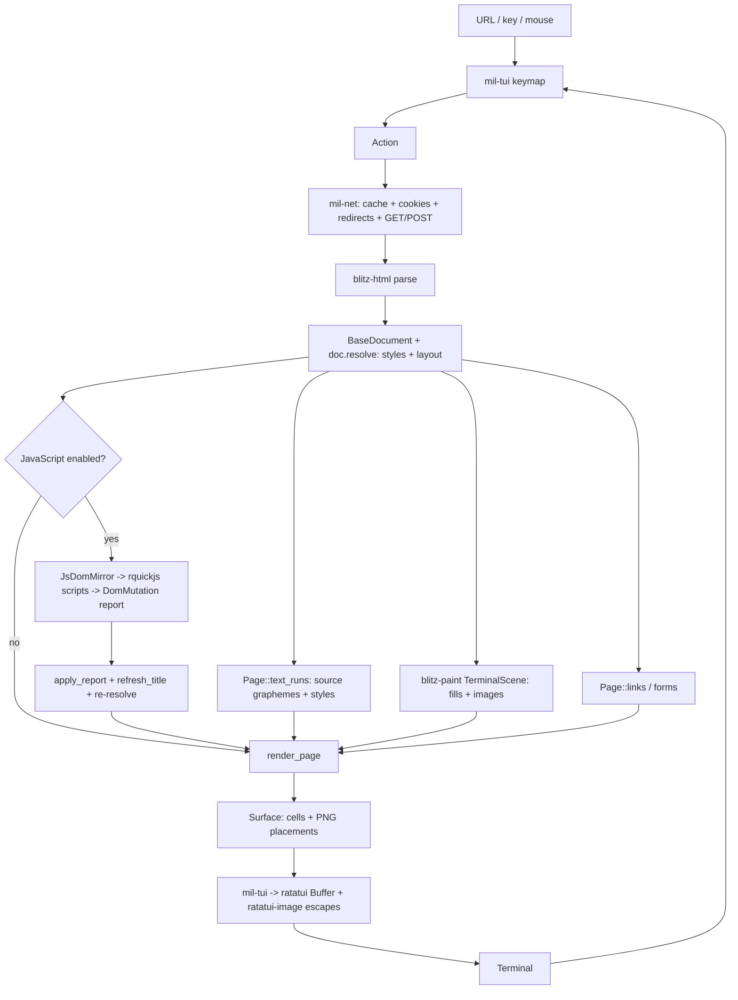

# Architecture

`mil` is a terminal web browser written in Rust. It uses the Blitz HTML/CSS
engine for parsing, cascade and layout, but instead of drawing to a GPU surface
it lowers the result into a terminal cell grid plus inline image placements. A
ratatui-based chrome (tab bar, omnibox, document viewport, status bar) surrounds
the page.

The workspace is split into focused crates so layout, networking and persistence
can be tested without a terminal.

## Crates

| Crate | Kind | Responsibility |
| --- | --- | --- |
| `mil-app` | binary (`mil`) | `clap` CLI, current-thread `tokio` event loop, terminal lifecycle, tab model, navigation, script invocation and session/bookmark wiring. |
| `mil-net` | library | `reqwest` + `rustls` fetching, manual `cookie_store` jar, bounded redirects, gzip/brotli decoding, bounded in-memory HTTP cache, `get`/`post_form` helpers. |
| `mil-dom` | library | `Page` wrapper around `blitz_dom::BaseDocument`: source text runs, link regions, backgrounds, hit testing, form discovery/serialization and `render_page`. |
| `mil-paint` | library | `TerminalScene`, a `PaintScene` recorder for fills and images; `Surface`, a cell grid (glyph + style) plus placed PNG images. No ratatui dependency. |
| `mil-tui` | library | ratatui chrome, `Surface` → `Buffer` conversion, ratatui-image protocol cache, keymap resolution, mouse handling and semantic `Action`s. |
| `mil-js` | library | Optional-at-runtime `rquickjs` 0.14 facade: a serialisable DOM mirror, recorded `DomMutation` report and `apply_report` to write those mutations back to a live Blitz document. |
| `mil-session` | library | TOML `Config`, JSON session/bookmarks snapshots, XDG path rules and atomic `0600` writes. Independent of the other crates. |

Dependency direction:

```
mil-app  -> mil-tui, mil-session, mil-net, mil-dom, mil-paint, mil-js
mil-dom  -> mil-paint (+ Blitz, Stylo, Taffy, Parley)
mil-tui  -> mil-paint (+ ratatui, ratatui-image, crossterm)
mil-js   -> Blitz + rquickjs (mirror built from a live BaseDocument)
mil-net  -> independent
mil-session -> independent
```

`mil-js` is glued to `mil-dom` in `mil-app`, not depended on by it: it builds a
`JsDomMirror` from the same HTML (or from the live document) and returns a
report that `mil-app` applies. `mil-paint` deliberately has no ratatui
dependency so the renderer can be exercised without a terminal.

## Data flow: loading a page

```
URL (omnibox / link / bookmark / CLI)
        |
        v
mil-net: cache lookup -> cookies -> redirects -> fetch (GET/POST)
        |
        v
blitz-html -> BaseDocument, then doc.resolve(): computed styles + layout
        |
        +-----------------------+------------------------+
        |                       |                        |
        v                       v                        v
Page::text_runs()      blitz-paint TerminalScene     Page::links()/forms()
(parley inline text)   (background fills + images)   (source text + hit regions)
        |                       |                        |
        +-----------------------+------------------------+
                                v
                    render_page() -> Surface (cells + PNG placements)
                                v
                 mil-tui Surface widget -> ratatui Buffer + image escapes
                                v
                              terminal
```

1. `mil-net` normalises the URL, consults the in-memory cache, attaches stored
   cookies, follows at most ten redirects and returns bytes plus headers.
   `Client::post_form` sends `application/x-www-form-urlencoded` bodies.
2. `Page::from_html` parses with `blitz-html` into a `BaseDocument` and caches
   the `<title>` text. `doc.resolve()` performs the cascade and layout.
3. **Hybrid text strategy.** Blitz/Parley emit font glyph IDs that cannot be
   reverse-mapped to source characters. `Page::text_runs()` therefore walks the
   resolved inline layout data and recovers each cluster's original text and
   computed style (colour, bold, italic, underline). `blitz-paint` is run only
   for solid backgrounds and image rectangles. This keeps text selectable and
   readable; exact glyph positions are approximated because CSS pixel advances
   do not equal terminal cell widths.
4. `render_page()` paints backgrounds first, places text graphemes contiguously
   in reading order per visual line, then clears image rectangles and attaches
   encoded PNGs. Cell styles become ratatui colours and modifiers; images are
   handed to ratatui-image.
5. `mil-tui` copies the visible cell range into the `Buffer`, clamps scroll to
   the document height and emits graphics escapes. Ratatui diffs the buffer on
   `draw`. Capability detection picks iTerm2 (OSC1337), Kitty or Sixel, with a
   half-blocks fallback (and alt text when no protocol is available). Protocol
   instances are cached per image id. `images.policy` and `images.protocol` are
   parsed but are not yet applied as overrides by the binary.

If JavaScript is enabled, an extra step runs between (2) and (4), described
below.

## JavaScript: the mirror architecture

rquickjs values are `!Send` and tied to a context lifetime, so callbacks never
capture a `&mut BaseDocument`. Instead:

1. `JsDomMirror` is built from the parsed document. Its node ids are the real
   Blitz node ids, so a recorded mutation can target the live document. Each
   mirror node carries tag, id/class, attributes, normalised inline style,
   text and child/parent links.
2. `JsEngine::run` creates a fresh runtime (16 MiB memory limit) and context.
   Globals backed by `Rc<RefCell<JsDomMirror>>` expose a small DOM/BOM facade:
   `document` (`title`, `cookie`, `write`, lookups), limited selectors,
   `textContent`/`innerHTML`, styles, classes, attributes, listeners/`click`,
   `location`, `console`/`alert`, timers and a placeholder `fetch`.
3. Writes are coalesced into a `JsReport` of `DomMutation`s, navigations, logs
   and errors. Timers use a virtual clock bounded to 16 callbacks / 1000 ms.
   Script errors are collected; later scripts still run.
4. `mil-app` calls `apply_report` on `Page::doc`, then **`Page::refresh_title()`**
   — the title is cached at parse time and a script may have changed
   `<title>` — and finally `doc.resolve()` again before repainting.

This is deliberately partial: no promises or network continuations, no XHR,
`localStorage`, RAF, modules, external scripts, complex selectors, DOM creation
or event dispatch beyond `click()` from script code. React/Vue-style SPAs are
out of scope. The memory limit and timer budget are robustness measures, not a
security sandbox.

## Forms

`mil-dom::form` owns form support:

- `Page::forms()` discovers `<form>` elements and their controls, resolving
  `action` against the page URL and honouring `form="id"` ownership.
- `Page::serialize_form` / `serialize_form_encoded` emit successful controls as
  GET query or POST body pairs, including submitter handling and line-ending
  normalisation.
- `Page::set_field_value` and `Page::toggle_field` mutate inputs through
  Blitz's own mutator, keeping the `value` attribute and live editor in sync.
- `Client::post_form` sends the encoded pairs via `mil-net`.

The library path is tested; focus traversal, interactive editing and an
end-to-end UI submit action are not wired into `mil-tui`/`mil-app` yet.

## Event flow: input to repaint

```
crossterm event -> mil-tui keymap -> Action -> mil-app tab mutation
                                      |
mouse click -> Page::links() rectangle hit test -> navigate
                                      v
                         next frame: render + terminal diff
```

Terminal events are mapped by `mil-tui` into `Action`s (Quit, Navigate, Scroll,
NewTab, Back, Bookmark, Click, ...); overrides come from `[keybindings]`.
`mil-app` applies them to the active tab. A click is resolved by testing the
pointer against the link rectangles derived from `<a href>` text runs. UI key
and mouse events are not dispatched to JS listeners yet; `click()` from script
code fires registered listeners during script execution. `Find` currently
collects a query and `ToggleHelp` only shows a status hint — matching,
highlighting and a full help screen remain open.

## Why a current-thread Tokio runtime?

`blitz_dom::BaseDocument` is `!Send`: it owns reference-counted,
interior-mutable structures that cannot safely move between threads. `mil-app`
uses `#[tokio::main(flavor = "current_thread")]` so the document, JS context and
paint surface stay on one thread for their lifetime. Network requests are still
async and overlap via `reqwest`; only the non-`Send` DOM is pinned to the loop.

## Why Blitz is pinned exactly

Blitz and its companion crates are pre-1.0 and expose internal traits that
change between patch releases. `mil` pins `blitz-dom =0.2.4`,
`blitz-html =0.2.0`, `blitz-paint =0.2.1` and `blitz-traits =0.2.0` exactly (no
caret ranges); upgrades are deliberate, tested changes. An unpinned update could
silently alter layout or the `PaintScene`/`BaseDocument` APIs. The lockfile is
committed and CI builds from it.

## Graphics and rendering notes

There is no Vello/GPU backend in the default build: the target is terminals
without GPU access. The only image fallback is ratatui-image's half-blocks
protocol (or alt text), not a rasterised full-page picture; full-page image mode
is not implemented. Terminal capability detection is best-effort, so text
fidelity still depends on the terminal's font and colour support. Unsupported
CSS (strokes/borders, box-shadow, gradients, SVG, custom paints, blend modes)
is ignored or approximated by Blitz rather than reimplemented here; `overflow:
auto`, 3D transforms and filters are partially supported upstream.

## Diagram



## Licensing note

The cell-rendering approach in `mil-paint` is adapted from `dioxus-tui`, which
is dual-licensed under MIT and Apache-2.0. Attribution and license notices are
retained in the adapted source files.
